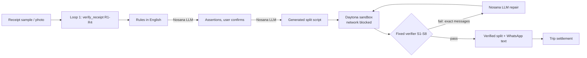

# SplitSnap: plain-English rules → a bill split verified to the cent

**Type the rules ("Arun didn't drink, it's Priya's birthday"), and SplitSnap writes custom split code on Nosana, runs it in a Daytona sandbox, checks it with a fixed verifier, and repairs it until every check passes.**

## Real-life problem
Splitting a group meal in Singapore is harder than it looks. Restaurant receipts add a 10% service charge, then 9% GST on top of that. Real groups have exceptions: someone didn't drink, a platter was shared by three of five people, the birthday person pays nothing. Dividing the total equally is unfair, and doing the math at the table is slow and error-prone. Existing split apps need every item typed in and only support fixed split types.

- Singapore's GST rose to 9% on 1 Jan 2024 (IRAS, iras.gov.sg), and it is charged on top of the usual 10% service charge, so a "$100" meal is really $119.90 and equal splits of the printed total hide who ordered what.

## Completeness: what works now
Working end to end in `app.py` (Streamlit):
1. Receipt: load a SAMPLE receipt or upload a photo, then edit the items table. **Loop 1** checks the receipt adds up (R1–R4).
2. Rules in plain English → Nosana LLM turns them into **checkable assertions** the user confirms.
3. Nosana LLM writes a split script → **Daytona sandbox** runs it → **fixed verifier** (8 checks) → automatic repair (max 3 attempts).
4. Verified per-person result, WhatsApp-ready message, `split.json` download.
5. Trip tab: combine outings and settle with fewer transfers.

Demo video: TODO link · Tests: `pytest` (13 tests, including the full fail → repair → pass loop offline).

Limitations (honest): sample receipts are synthetic and labelled TEST DATA. Photo reading only works if a vision model is served (`NOSANA_VISION_MODEL`); otherwise the items table is edited by hand. Discounts are not allocated per person. The demo LLM endpoint is Ollama serving `qwen2.5-coder:7b` on a Nosana GPU node. The Trip tab stores outings in Neo4j AuraDB Free when `NEO4J_URI` is set (it was for the demo), and falls back to local settlement otherwise.

## Innovation: autonomous feedback loops
- **Loop 1 (receipt):** items must sum to the printed subtotal, and SC/GST must match 10%-then-9%. Failures name the exact mismatch (`R1 FAIL: items sum to 13200, printed subtotal is 15200 (off by -2000 cents)`). With a vision model, the model re-reads with those failures as hints (max 2); otherwise the user fixes the flagged line.
- **Loop 2 (split):** the LLM never does arithmetic. It writes code; Daytona executes it; our verifier judges the output; failure messages go back to the LLM for repair.
- **Grounding check on the model's rules:** `core/rules.py: ground()` drops per-item share rules on items the user never mentioned and shows the user why. In live runs the 7B model copied "Dan had 2 of the 3 beers" onto the wine; this check caught it.
- **Two independent interpretations must agree:** rules → assertions (user-confirmed) and rules → code. The verifier checks the code's output against the assertions (S6).
- **The verifier is hand-written and never sent to the model as editable.** It runs locally on the returned JSON, outside the sandbox, so generated code can't tamper with it (`core/verifier.py`).

| Check | Rule |
|---|---|
| S1 | Valid JSON with allocations, charges, totals |
| S2 | Every item allocated exactly to the cent |
| S3 | Shares sum exactly to the receipt total |
| S4 | Exactly the listed people appear |
| S5 | No negative amounts |
| S6 | Every confirmed rule holds |
| S7 | Each total = items + service + GST |
| S8 | Service and GST shares sum to the printed charges |

## Sponsor tech
**Daytona: runs untrusted, model-generated code (essential).** Rules are open-ended, so each receipt gets its own generated script. That code is untrusted, so it only ever runs in Daytona.
- `core/sandbox.py` → `SplitSandbox.__enter__` creates the sandbox (`CreateSandboxFromSnapshotParams(language="python", ephemeral=True, auto_stop_interval=5, network_block_all=True)`), `SplitSandbox.run` calls `sandbox.process.code_run(...)` with a 20s timeout, `__exit__` deletes it.
- One sandbox per split run, reused across repair attempts. Network blocked. Sandbox ID shown on every attempt in the UI.

**Nosana: open-model inference for all reasoning (essential).** The demo runs `qwen2.5-coder:7b` (Qwen2.5-Coder 7B Instruct) on Ollama, deployed on the Nosana network from `nosana-job-ollama.json`. `core/llm.py` calls Ollama's OpenAI-compatible `/v1` endpoint. Nosana's stock Ollama template failed on our deployment because its model folder was mounted read-only (`mkdir /root/.ollama/models/manifests-v2: read-only file system`), so our job file pulls the model at startup instead. `nosana-job.json` (vLLM + Qwen2.5-Coder-7B-Instruct-AWQ) is an alternative that was not used for the demo.
- `core/llm.py` → `chat()` (OpenAI client pointed at the Nosana job URL)
- `core/rules.py` → `interpret()` rules → assertions
- `core/codegen.py` → `generate()` writes the split script, `repair()` fixes it from verifier failures
- `core/extract.py` → `extract()` receipt photo → JSON (only with a vision model)

**Neo4j: trip ledger across outings.** Each verified split can be added to a trip. `core/ledger.py` → `save_outing()` writes `(:Group)-[:HAS_OUTING]->(:Outing)`, `(:Person)-[:MEMBER_OF]->(:Group)`, `(:Person)-[:PAID {cents}]->(:Outing)` and `(:Person)-[:OWES_SHARE {cents}]->(:Outing)`. One Cypher query (`NET_QUERY`, `net_balances()`) computes everyone's net across the whole trip, and `core/settle.py` turns that into the fewest transfers ("N IOUs → M transfers"). Each app session gets its own Group id. It is used only if `NEO4J_URI` is set; otherwise the same settlement runs locally. Live check (TEST DATA, 3 outings with different payers): the nets returned by Neo4j summed to exactly 0.

## Architecture


## Sample attempt log
Real live runs on the `bistro` sample (Nosana `qwen2.5-coder:7b`, Daytona sandboxes), 31 Oct 2026.

Before we tightened the code template in `core/codegen.py`, the loop caught and repaired real failures but did not reach a pass in 3 attempts:
```
codegen  qwen2.5-coder:7b 8.4s
sandbox  1c244dfd-921b-46fc-9c6a-902109eed0c1  network_blocked=True  0.7s
Attempt 1  exit 1  RUNTIME FAIL: NameError: name 'item_cents' is not defined
Repair 1   8.9s
Attempt 2  exit 0  5/8 passed  S2 FAIL: allocation references unknown item_id 'Arun'  (item_id/person swapped)
Repair 2   12.6s
Attempt 3  exit 0  5/8 passed  -> FAIL reported to user, no result shown
```
After the fix (template with the largest-remainder helper; the model writes the rule logic):
```
interpret  3.0s  excluded_from_category(Arun, drink), pays_nothing(Priya), item_shared_by(i1: Arun, Mei, Dan), weight(i4: Dan 2, Siti 1)
           dropped: "not mentioned in your rules: weight on 'House Red Wine (glass)'"   (model copied the beer rule onto the wine; caught by rules.ground)
sandbox    dccbec1e-2fa3-40da-b42e-a2694e425b30  network_blocked=True
Attempt 1  exit 0  8/8 passed  1.4s     (whole run 12s)
Totals: Arun 31.17, Priya 0.00, Mei 44.78, Dan 68.74, Siti 37.56  = 182.25 (receipt total)
```
Offline test of the fail -> repair -> pass path (`tests/test_agent_loop.py`, fake model):
```
Attempt 1  exit 0  4/8 checks passed          (naive script: equal split, ignores rules)
  S2 FAIL: item i1 'Seafood Platter' line is 4800, allocations sum to 0 (off by -4800)
  ... (S2 for each item)
  S7 FAIL: Arun: total 3645 but items 0 + service 0 + GST 0 = 0
  S8 FAIL: service shares sum to 0, printed service charge is 1520
  S6 FAIL: rule 'Priya pays nothing' broken: Priya total is 3645
  S6 FAIL: rule 'item i4 split by weights {'Dan': 2, 'Siti': 1}' broken: Dan got 0, expected about 2000
Repair 1: verifier failures sent back to the LLM
Attempt 2  exit 0  8/8 checks passed
```

## Setup
```bash
pip install -r requirements.txt
cp .env.example .env        # add DAYTONA_API_KEY and the Nosana job URL
python smoke.py             # checks Daytona + Nosana
pytest -q                   # 13 tests
streamlit run app.py
```
Start the model: on the Nosana dashboard, choose Create Deployment → Custom deployment → Edit as JSON, paste `nosana-job-ollama.json` and deploy. Put the endpoint URL in `NOSANA_BASE_URL` and set `NOSANA_TEXT_MODEL=qwen2.5-coder:7b`.
